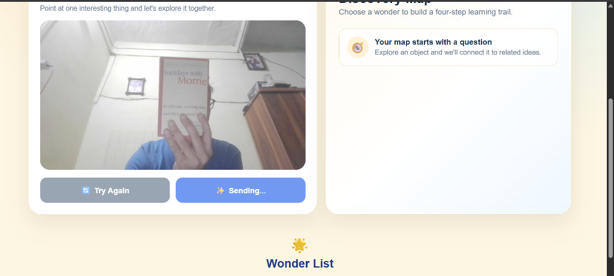
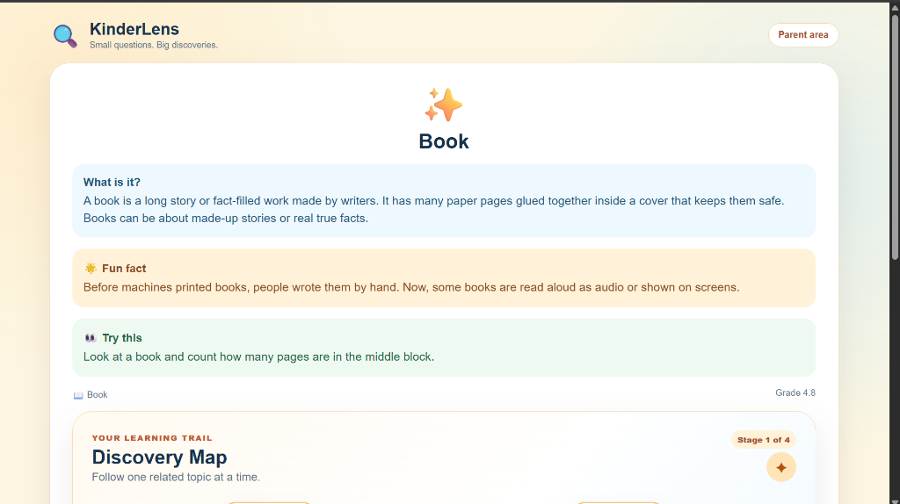
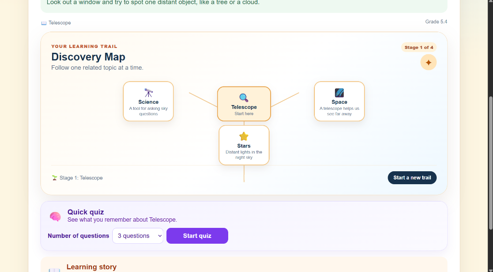
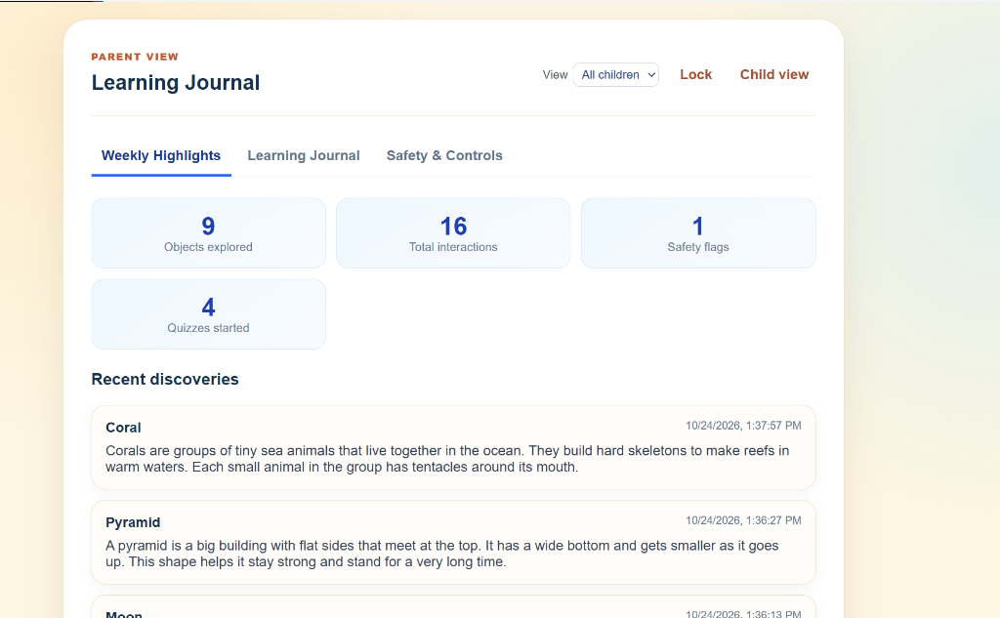
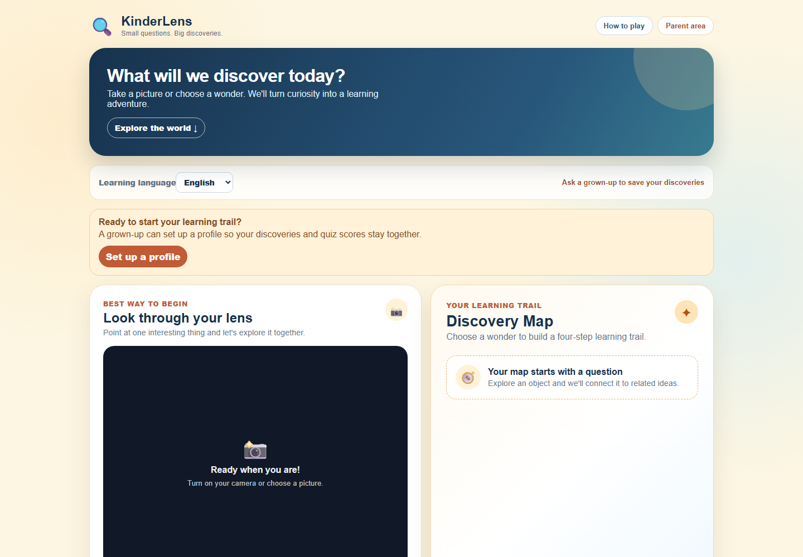
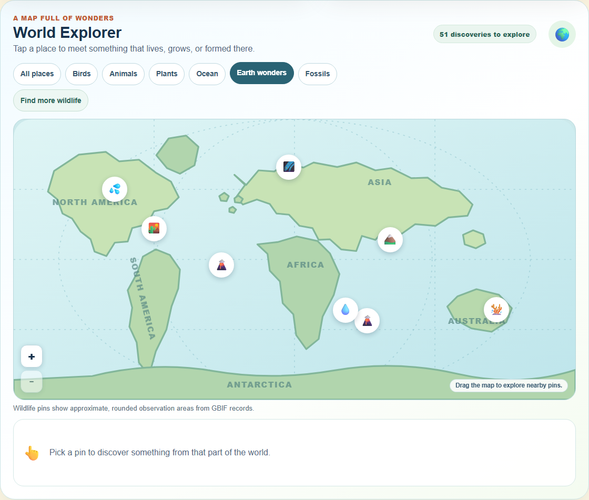
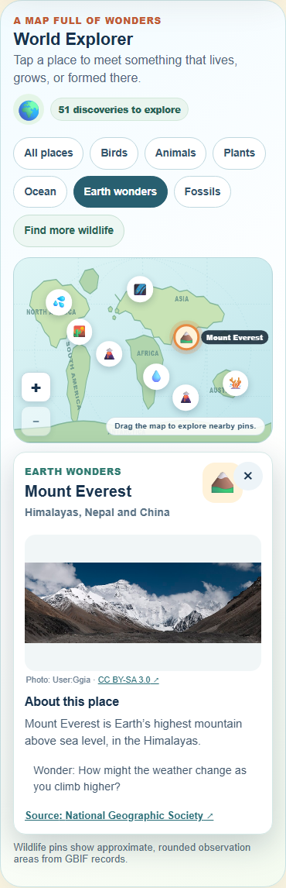
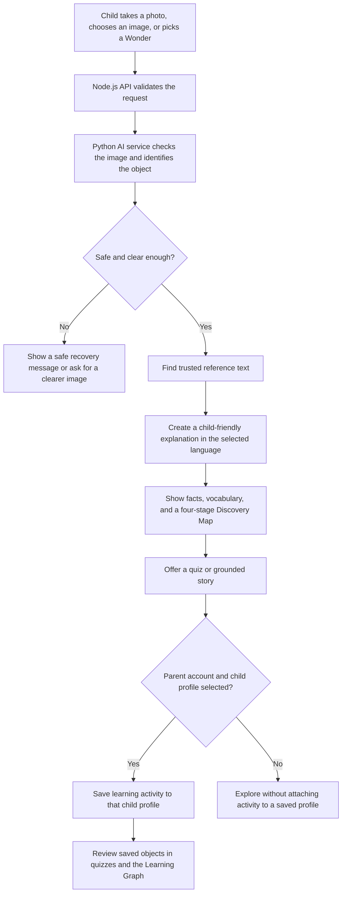
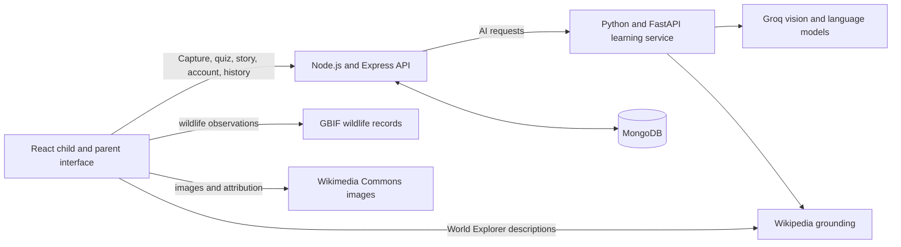

# KinderLens

**Small questions. Big discoveries.** KinderLens is a learning app for children
ages 6–8. A child can take a picture or choose a wonder, learn a short,
source-grounded explanation, follow related ideas, and revisit past discoveries.
Parents can manage child profiles and saved learning activity.

## See it in action

These screenshots were captured from the running frontend, illustrating the end-to-end exploratory learning workflow:

### 1. Live Camera Capture
Hold any everyday object in front of the lens. The camera stream captures the frame with one tap.



### 2. Object Identification & Grounded Learning Card
KinderLens accurately identifies the object (e.g. *Book*), produces a 3-sentence verified explanation, an engaging fun fact, a physical observation task, and an automated readability score.



### 3. Discovery Map Concept Graph & Quiz
Follow a multi-stage cognitive branch from the discovered object into connected scientific domains (e.g. *Telescope* connecting to *Science*, *Space*, and *Stars*), and launch an instant interactive quiz.



### 4. Parent Profile Control & Learning Journal
Parents can switch between child profiles, review weekly learning metrics (objects explored, quizzes taken, safety flags), inspect timestamped discovery logs, and manage privacy settings.



### 5. Home and Discovery Workspace



### 6. World Explorer (Desktop & Mobile)





## What children can do

### Discover something nearby

- Take a photo with the camera or choose an image from the device.
- Get the main object identified and a short explanation written for young
  learners.
- See a source for grounded facts, a fun fact, a safe observation activity, and
  simple meanings for selected science or nature words.
- If the image is unclear or could show more than one thing, KinderLens asks for
  a clearer picture instead of pretending to know.
- If content fails its safety or grounding checks, the app shows a friendly
  recovery message rather than invented learning content.

### Explore a Wonder

The curated **Wonder List** offers ready-to-explore topics for children who do
not have a picture to capture. Exploring a topic uses the same grounded
explanation, vocabulary, quiz, and story experiences.

### Follow a Discovery Map

After an object is identified, the **Discovery Map** suggests related learning
ideas, such as its parts, materials, uses, or a nearby science topic. Children
can follow one connection at a time through a four-stage trail.

### Explore the World

**World Explorer** is a separate map of animals, birds, plants, fossils, and
Earth wonders. Children can filter by category, select a pin for a short
description and source, and move around the map with zoom and drag controls.
Wildlife observations come from GBIF and are shown as rounded, approximate
areas—not exact animal locations. Wikipedia and Wikimedia Commons can provide
extra descriptions, images, and attribution. Curated discoveries remain
available when a live data source is unavailable.

### Quiz, read, and revisit

- Start a quick quiz about a topic, with a choice of 3, 5, or 10 questions.
- Read explanations after answering, to help children understand the answer.
- Generate a short learning story based on grounded reference facts.
- Revisit saved discoveries with a review quiz, including early reviews and
  catch-up when a review is overdue.
- View a **Learning Graph** of saved objects. It connects discoveries when their
  grounded explanations share a meaningful idea and explains the link.

The Discovery Map follows ideas from the current object. The Learning Graph
shows relationships among previously saved objects.

### Learn in three languages

The child-facing experience supports **English, Hindi, and Hinglish**. Language
changes the wording of the learning experience; factual content remains tied to
its grounding source.

## How a discovery works



## Parent tools and privacy

- Parents can register or sign in, create child profiles, and choose which child
  is learning.
- Saved activity is scoped to the signed-in parent and the selected child
  profile.
- The Parent Dashboard provides history controls, including export and deletion.
- Raw uploaded photos are analyzed for the current request and are not stored in
  interaction history.
- Parent sessions use protected cookies; AI and authentication routes have
  request limits.

See [Safety Principles](docs/SAFETY_PRINCIPLES.md) for the project’s content,
grounding, privacy, and account-boundary rules.

## Architecture



The browser is a React app served by Vite during development. The Express API
handles accounts, child profiles, captures, quizzes, stories, and saved activity.
The FastAPI service handles vision and learning-content generation. MongoDB
stores parent accounts, child profiles, and interaction history. The World
Explorer also reads public GBIF, Wikipedia, and Wikimedia Commons data.

## Fork and clone

To work on your own copy, click **Fork** on the
[KinderLens GitHub repository](https://github.com/hiArpit/Kinderlens), then clone
your fork:

```bash
git clone https://github.com/<your-github-username>/Kinderlens.git
cd Kinderlens
```

To clone the original repository instead:

```bash
git clone https://github.com/hiArpit/Kinderlens.git
cd Kinderlens
```

## Run locally

Docker is not needed. Install Git, Node.js with npm, Python, and MongoDB. Start
MongoDB locally before starting the backend. The AI features also need a Groq
API key. Keep API keys and local `.env` files private; do not commit them.

The commands below use Windows PowerShell. Open three terminals in the cloned
repository, one for each service.

### 1. Configure and start the AI service

Create `ai-service/.env` from its example file, then add your Groq API key:

```powershell
Copy-Item ai-service/.env.example ai-service/.env
```

Install dependencies and run the service on port 8000:

```powershell
cd ai-service
python -m venv .venv
.\.venv\Scripts\python.exe -m pip install -r requirements.txt
.\.venv\Scripts\python.exe -m uvicorn app.main:app --reload --port 8000
```

### 2. Configure and start the backend

In a second terminal, create `backend/.env`:

```powershell
Copy-Item backend/.env.example backend/.env
```

The example uses MongoDB at `mongodb://127.0.0.1:27017/kinderlens`. Edit
`MONGODB_URI` if your database is elsewhere. Set `PARENT_SESSION_SECRET` to a
random value of at least 32 characters. Change `PARENT_PIN` if you use the
local-development PIN flow.

Install dependencies and run the API on port 5000:

```powershell
cd backend
npm install
npm run dev
```

### 3. Start the frontend

In a third terminal:

```powershell
cd frontend
npm install
npm run dev
```

Open <http://localhost:3000>. Vite proxies `/api` requests to the backend at
`http://localhost:5000`. The frontend uses browser camera access only after the
child chooses to turn on the camera. Browsers require localhost or HTTPS for
camera access.

For macOS or Linux, use `cp` instead of `Copy-Item`, activate the virtual
environment with `source .venv/bin/activate`, and run `python -m pip` and
`uvicorn app.main:app --reload --port 8000` from `ai-service`.

## Checks

Backend unit and route tests:

```powershell
cd backend
npm test
```

Frontend production build and browser smoke tests:

```powershell
cd frontend
npm run build
npm run test:e2e
```

AI-service unit tests (install pytest into the local virtual environment first):

```powershell
cd ai-service
.\.venv\Scripts\python.exe -m pip install pytest
.\.venv\Scripts\python.exe -m pytest
```

The seeded evaluation at `evaluation/run_evals.py` sends live requests to the AI
service and uses the configured model API. Run it only when the service is
available and you intend to use those API calls.

## Repository layout

```text
ai-service/       FastAPI vision, grounding, safety, quiz, and story services
backend/          Express API, accounts, profiles, and saved activity
frontend/         React app, child learning flows, maps, and parent dashboard
evaluation/       Seeded AI evaluation cases and image fixtures
docs/             Safety principles, roadmap, and deployment notes
```

See [the roadmap](docs/ROADMAP.md) and [deployment guidance](docs/DEPLOYMENT.md)
for more detail.
