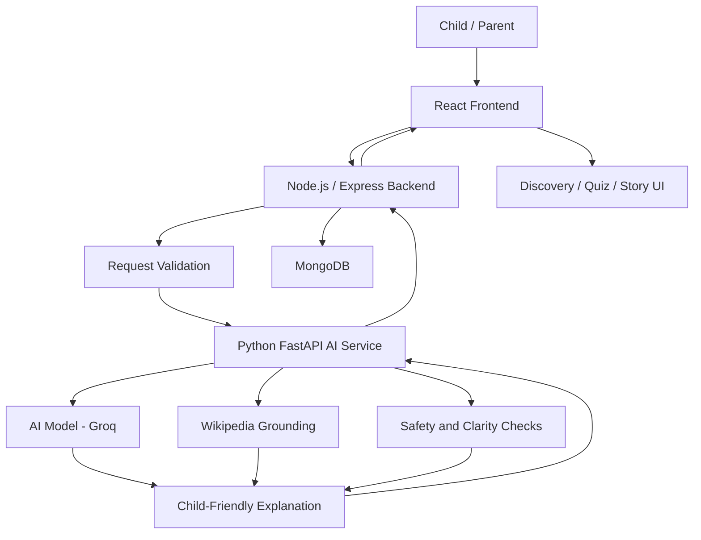

# KinderLens – System Architecture

## 1. Overview

KinderLens is an AI-powered educational discovery platform designed for children aged 6–8.

It helps children explore the world around them by taking pictures, discovering objects, learning interesting facts, and participating in quizzes and stories.

The system follows a modular architecture consisting of a frontend, backend API, AI service, and database.

## 2. Technology Stack

| Layer | Technology | Responsibility |
|---|---|---|
| Frontend | React + Vite | User interface and interaction |
| Backend | Node.js + Express | API handling, authentication, and application logic |
| AI Service | Python + FastAPI | Image understanding and AI-powered explanations |
| Database | MongoDB | Parent accounts, child profiles, and learning history |
| AI Models | Groq vision/language models | Image recognition and explanation generation |
| Knowledge Source | Wikipedia | Grounding explanations in reference information |
| Wildlife Data | GBIF | Wildlife observations for World Explorer |
| Image Source | Wikimedia Commons | Educational images and attribution |

## 3. High-Level Architecture

The application is divided into four major components:

### 3.1 Frontend – React + Vite

The frontend provides the interface through which children and parents interact with KinderLens.

Main responsibilities:

- Photo capture and image upload.
- Displaying identified objects.
- Showing child-friendly explanations and fun facts.
- Displaying vocabulary and observation activities.
- Wonder List and Discovery Map.
- World Explorer interface.
- Quiz and story interfaces.
- Parent dashboard and learning history.

The frontend communicates with the backend through HTTP API requests.

### 3.2 Backend – Node.js + Express

The backend acts as the central application layer.

Main responsibilities:

- Receiving frontend API requests.
- Validating uploaded images and requests.
- Managing parent authentication.
- Managing child profiles.
- Communicating with the AI service.
- Handling learning history.
- Managing saved discoveries, quizzes, and stories.
- Enforcing parent and child data access rules.

The backend communicates with MongoDB for persistent data and the Python AI service for AI-related operations.

### 3.3 AI Service – Python + FastAPI

The AI service handles image understanding and educational content generation.

Main responsibilities:

- Processing uploaded images.
- Identifying objects.
- Generating explanations using AI models.
- Checking clarity and confidence.
- Applying safety checks.
- Preparing age-appropriate explanations.
- Supporting quiz and story generation using grounded information.

The AI service uses external AI models and trusted reference information where applicable.

### 3.4 Database – MongoDB

MongoDB is used to store application data.

Expected data categories include:

- Parent account information.
- Child profiles.
- Saved discoveries.
- Learning history.
- Quiz and story records.
- Related learning information.

Raw uploaded photos are analyzed per request and are not stored in interaction history, as described in the project requirements.

## 4. System Workflow

The main discovery workflow is:

1. A child captures a photo or selects a topic from the Wonder List.
2. The frontend sends the request to the backend.
3. The backend validates the request.
4. The backend communicates with the Python AI service.
5. The AI service identifies the object.
6. The system checks the result for safety and clarity.
7. Relevant reference information is retrieved from trusted sources.
8. The AI generates a child-friendly explanation.
9. Additional learning content is prepared, such as facts, vocabulary, and Discovery Map connections.
10. The child can explore quizzes and stories.
11. If a parent account and child profile are selected, the learning activity can be saved.

## 5. Architecture Diagram



## 6. External Data Sources

KinderLens uses external sources to support educational discovery.

### Wikipedia
- Provides reference information about identified objects.
- Helps ground explanations in factual information.
- Supports reliable educational content generation.

### GBIF
- Provides wildlife observation data for World Explorer.
- Supports animal and biodiversity exploration.
- Displays approximate observation areas rather than exact animal locations.

### Wikimedia Commons
- Provides educational images.
- Supports image-based exploration.
- Image attribution and licensing information should be respected.

## 7. Safety and Privacy Architecture

Safety is an important part of KinderLens.

The system follows these principles:

- No open-ended chat functionality.
- No companion-style framing.
- Parent visibility into children's learning activities.
- Data minimisation.
- Uploaded photos are not retained in interaction history.
- Safety checks before educational content is delivered.
- Parent and child data access must be properly restricted.
- Unclear or unsafe outputs should be blocked or replaced with safe fallback messages.

For detailed safety requirements, refer to:

[`SAFETY_PRINCIPLES.md`](./SAFETY_PRINCIPLES.md)

## 8. Project Directory Structure

The project is organized into separate application components.

```text
Kinderlens/
│
├── frontend/
│   └── React + Vite application
│
├── backend/
│   └── Node.js + Express API
│
├── ai-service/
│   └── Python + FastAPI AI service
│
├── evaluation/
│   └── AI evaluation and testing
│
├── docs/
│   ├── screenshots/
│   ├── ARCHITECTURE.md
│   ├── DEPLOYMENT.md
│   ├── ROADMAP.md
│   └── SAFETY_PRINCIPLES.md
│
└── README.md
```

## 9. Design Principles

The architecture follows these design principles:

1. **Modularity:** Frontend, backend, and AI service have separate responsibilities.
2. **Scalability:** Individual services can be improved independently.
3. **Security:** Parent authentication and child data access must be protected.
4. **Privacy:** Only necessary learning data should be retained.
5. **Reliability:** AI-generated explanations should be checked against trusted information.
6. **Child Safety:** All educational content must pass appropriate safety checks.
7. **Maintainability:** Each component should remain easy to test and update.

## 10. Related Documentation

- [Project README](../README.md)
- [Development Roadmap](./ROADMAP.md)
- [Deployment Guide](./DEPLOYMENT.md)
- [Safety Principles](./SAFETY_PRINCIPLES.md)

---

**KinderLens – Small questions. Big discoveries.**